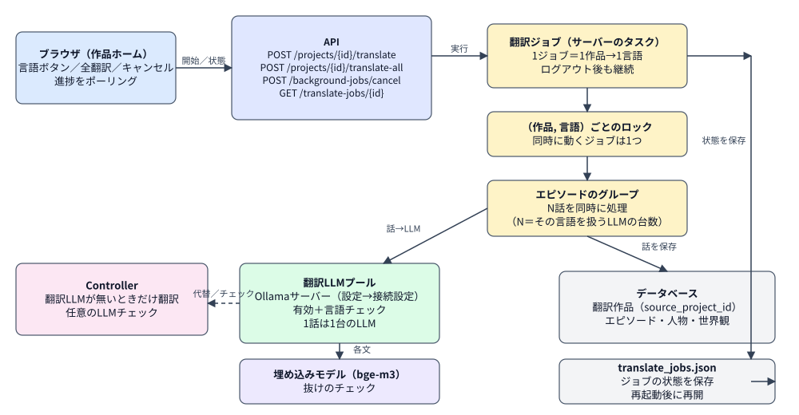
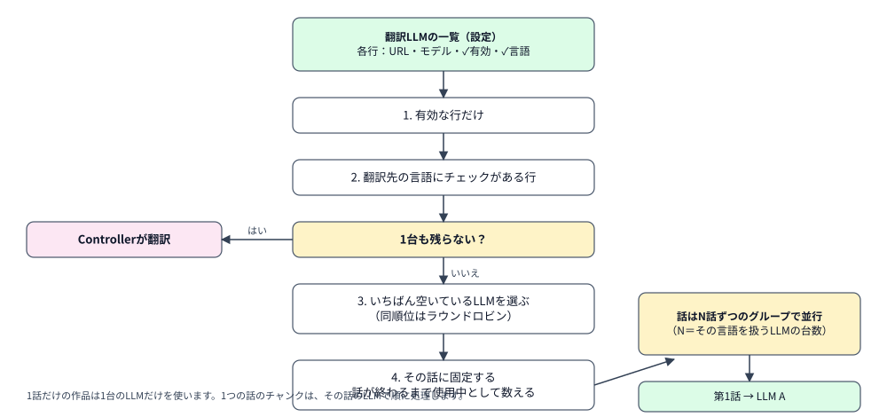
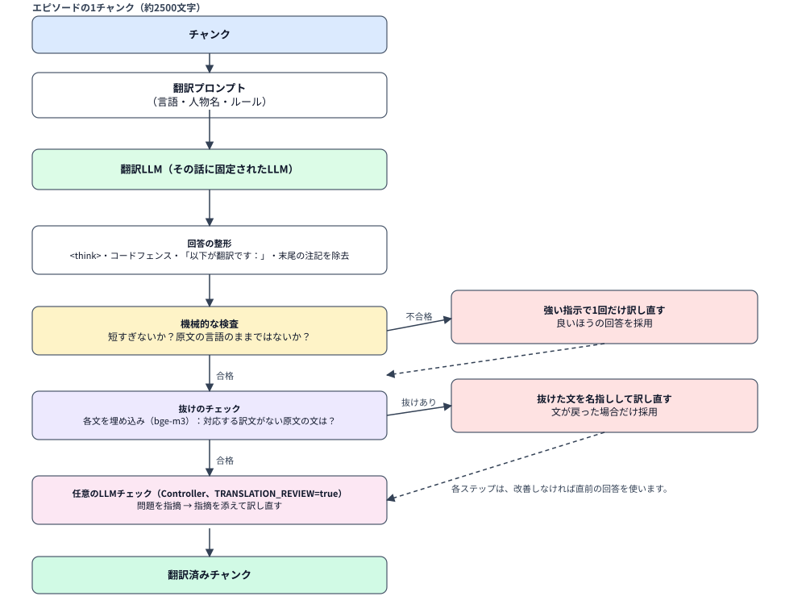
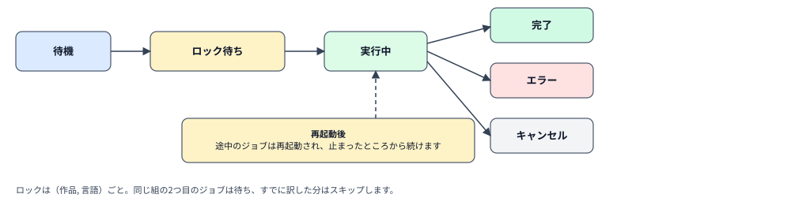

[← マニュアルトップ](index.md) | [English](translation.md)

# 翻訳のフローと仕組み

作品を別の言語に翻訳する流れを、誰が何をするか、作品をどう分けるか、翻訳LLMをどう選ぶか、何を検査するか、再起動で何が残るか、の順に説明します。画面の使い方は[操作マニュアル](user-guide.ja.md#翻訳)、モデルの設定は[動作要件](requirements.ja.md)を参照してください。

## 1. 全体像

- ブラウザは、ジョブの**開始・確認・キャンセル**をするだけです。実際の処理はサーバーのタスクで動くので、ログアウトしたりタブを閉じたりしても続きます。
- 1つのジョブは**1作品を1言語に**翻訳し、元の作品を記録した（`source_project_id`）**別の翻訳作品**を作る（または不足分を補う）ものです。元の作品は変更されません。「全翻訳」は、他の7言語を順に実行する外側のジョブです。
- 翻訳の呼び出しは、**翻訳LLMプール**（設定→接続設定に登録したOllamaサーバー）に送られます。**Controller**は、使える翻訳LLMが無いときだけ翻訳し、それ以外は検査に専念します。
- 抜けのチェックには、文の埋め込み（bge-m3）を使います。ジョブの状態は`translate_jobs.json`に保存され、途中のジョブを再開できます。

## 2. 1つのジョブがすること

1. （作品, 言語）の**ロックを取る**。同じ組の2つ目のジョブは、同じ話を二重に訳さず待ちます。ロックを取れたら、まだ足りない分だけ処理します（§6）。
2. 翻訳作品を作る（前回の作品があればそれを使う）。作品名（末尾に「[言語名]」を付ける）とあらすじは翻訳し、ジャンルと作品ルールはコピーします。**人物と世界観の項目は、翻訳せずそのままコピー**します（足りない分だけ追加）。
3. **処理が必要な話**を決める：話がない、またはタイトル・あらすじ・本文が空か原文の25%未満の短さ。揃っている話はスキップします。
4. 話を**N話ずつ**翻訳する（N＝その言語を扱うLLMの台数。Controllerだけなら1）。1つの話は**最初から最後まで1台のLLM**で、章名→タイトル→あらすじ→本文（チャンク順）の順に訳し、終わりしだいデータベースとディスクのミラーに保存します。
5. 「◯話を翻訳しました…（抜けていた◯文を補いました）」のようなメッセージで終わります。進捗は「処理済み話数／総話数」で、スキップした話も含みます。

## 3. 翻訳LLMの選び方

一覧の行は、**有効**で、**翻訳先の言語にチェックがある**ものだけが使われます。1台も残らない（一覧が空、すべて無効、その言語を扱う行がない）ときは**Controller**が翻訳します。候補の中では**いちばん空いている**LLMを選びます（同順位はラウンドロビン）。選んだLLMは**その話に固定**され、話が終わるまで使用中として数えられるので、同時に訳す話は別々のLLMに分かれ、1話だけの作品は1台しか使いません。Qwen3系には`/no_think`を付け、長い思考の段階を省きます。

## 4. 1つのチャンクで起きること

話は、行の区切りで約2500文字のチャンクに分けられます（段落の区切りと台詞が保たれます）。

| ステップ | 内容 | 設定 |
|---|---|---|
| プロンプト | 翻訳先の言語への忠実な翻訳を依頼。改行と台詞を保ち、人物名を統一し、前置きや注記は付けない | 組み込み |
| 整形 | `<think>…</think>`、回答全体を囲むコードフェンス、前置きの1行、末尾の「Note: …」を除去 | 常に |
| 機械的な検査 | 原文の25%未満の短さ、または大部分が原文の言語のままなら、1回だけ訳し直す | 常に |
| 抜けのチェック | 原文と訳文の各文を多言語モデルで埋め込み、似た対応文がない（類似度0.66未満）原文の文を「抜け」とみなす → その文を名指しして訳し直し、文が戻った場合だけ採用 | `TRANSLATION_OMISSION_CHECK`（有効）、`TRANSLATION_EMBED_MODEL`（`bge-m3`。`ollama pull bge-m3`が必要） |
| LLMチェック | Controllerが原文と訳文を見比べて問題を挙げる → 指摘を添えて訳し直す。実測で信頼できなかったため既定は無効 | `TRANSLATION_REVIEW`（無効） |

どのステップも、新しい回答が良くなければ直前の回答を使います。チェックが失敗しても（例：埋め込みモデルが未導入）、翻訳は止まりません。

## 5. ジョブの状態

- **待機 →（ロック待ち）→ 実行中 → 完了／エラー／キャンセル。**
- 「キャンセル」でジョブを止めます。訳した分は残り、次回は続きから翻訳します。
- ジョブの状態は`translate_jobs.json`（保存先フォルダ）に保存されます。サーバーを再起動すると、途中のジョブは再起動され、止まったところから続きます。全翻訳は、止まった言語から再開します。（翻訳ジョブはデータベースには保存されません。自動執筆とインポートは保存されます。）
- ダッシュボードの「サーバーで実行中の処理」と作品ホームの状態表示は、同じジョブの一覧を読んでいます。

## 6. 再開と二重翻訳の防止

- **同じ作品・同じ言語**：翻訳作品は`source_project_id`で見つかり、複製ではなく**不足分を補います**。欠けた部分と短すぎる部分だけ訳し直します。
- **（作品, 言語）ごとに同時に動くジョブは1つ**（ロック）。`POST /projects/{id}/translate`は、実行中のジョブがあれば新しく始めず、そのジョブを返します。
- `source_project_id`が記録される前に作った翻訳作品は認識されず、新しい翻訳作品になります。

## 7. 各設定の場所

| 内容 | 場所 |
|---|---|
| 翻訳LLM（URL・モデル・有効・言語）最大8台 | 設定→接続設定→翻訳LLM（`runtime_config`の`translator_pool`） |
| ControllerのURL・モデル | 設定→接続設定→Ollama 2（Controller） |
| 1回の呼び出しのタイムアウト | `TRANSLATOR_TIMEOUT_SECONDS`（900） |
| 抜けのチェック／埋め込みモデル | `TRANSLATION_OMISSION_CHECK`、`TRANSLATION_EMBED_MODEL` |
| LLMチェック | `TRANSLATION_REVIEW` |
| (サーバー, モデル)ごとの同時呼び出し数 | `OLLAMA_MAX_CONCURRENCY`（既定1）。速くなるのは、別のサーバーを使うとき |

## 8. コードの場所

`apps/api/app/translator.py`（ジョブ・ロック・チャンク・検査）・`app/ollama.py`（`translator_generate`、`pin_translator`、LLMの選択）・`app/omission.py`（文の分割と埋め込みによる検査）・`app/runtime_config.py`（プールの読み込み）・`apps/web/app/components/ProjectHome.tsx`と`SettingsPanel.tsx`（画面）。
