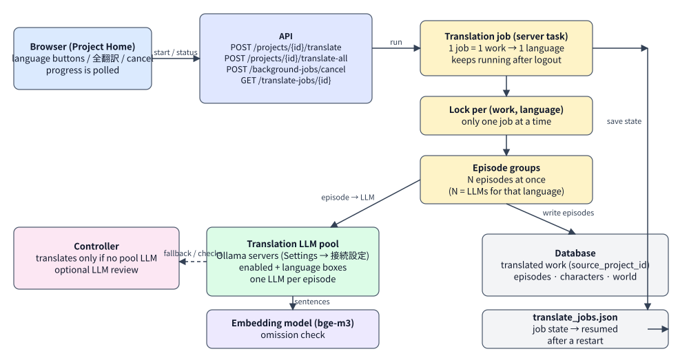
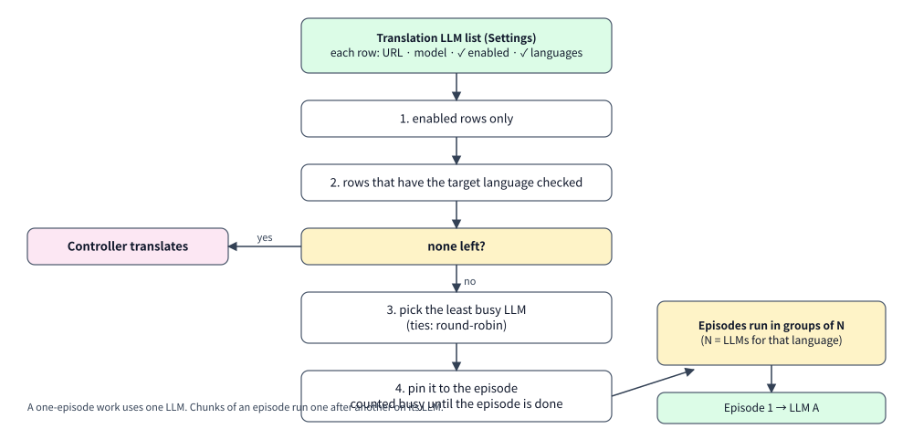
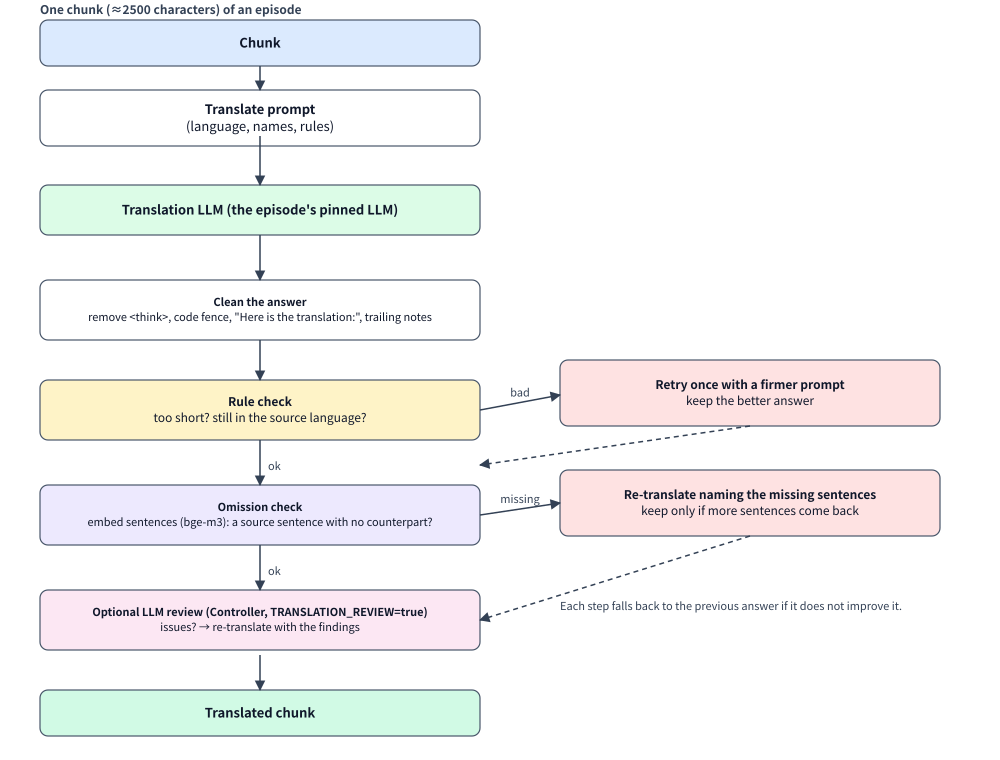
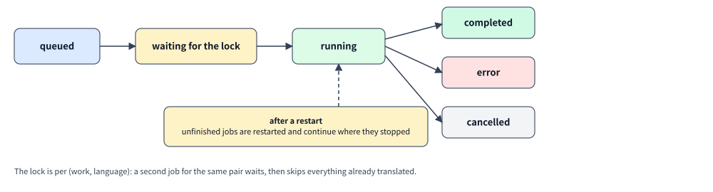

[← Manual home](index.md) | [日本語](translation.ja.md)

# Translation: flow and architecture

How a work is translated into another language: who does what, how the work is split up, how the translation LLMs are chosen, what is checked, and what survives a restart. For the screens, see the [User Guide](user-guide.md#translation); for the model settings, [Software Requirements](requirements.md).

## 1. Big picture

- The browser only **starts, watches and cancels** a job. The work happens in a server task, so it keeps going after you log out or close the tab.
- One job translates **one work into one language** and produces (or tops up) a **separate translated work** that remembers its source (`source_project_id`). The original is never changed. 「全翻訳」 is one outer job that runs the 7 other languages one after another.
- Translation calls go to the **translation LLM pool** (Ollama servers you list in Settings → 接続設定). The **Controller** translates only when no pool LLM is available, and otherwise concentrates on checking.
- Sentence embeddings (bge-m3) are used by the omission check. Job state is written to `translate_jobs.json` so unfinished jobs can resume.

## 2. What one job does

1. **Wait for the lock** for this (work, language). A second job for the same pair waits instead of translating the same episodes again; once it gets the lock it only does what is still missing (see §6).
2. Create the translated work — its name (with a 「[language]」 suffix) and synopsis are translated; genre and rules are copied — or reuse the one from an earlier run. **Characters and world entries are copied as they are (not translated)**; only ones that are missing are added.
3. Decide **which episodes need work**: a missing episode, or a title / summary / body that is empty or shorter than 25 % of the original. Complete episodes are skipped.
4. Translate the episodes **N at a time** (N = number of LLMs that handle this language; 1 when only the Controller is available). Each episode is translated by **one LLM from start to finish** — chapter, title, summary, then the body chunk by chunk — and saved to the database and the on-disk mirror as soon as it is done.
5. Finish with a message such as 「◯話を翻訳しました…（抜けていた◯文を補いました）」. Progress is `processed episodes / total`, skipped ones included.

## 3. Choosing the translation LLM

Rows of the list are used only if **enabled** and the **target language is checked**. If nothing is left (empty list, all off, or no row handles that language) the **Controller** translates. Among the candidates the **least busy** LLM is chosen (ties: round-robin). The LLM is **pinned to the episode** and counted busy until the episode is finished, so episodes translated at the same time land on different LLMs, and a one-episode work uses just one. Qwen3 models get `/no_think` appended (skips the long reasoning phase).

## 4. What happens to one chunk

Episodes are cut into chunks of about 2500 characters at line breaks (so paragraph breaks and dialogue survive).

| Step | What it does | Setting |
|---|---|---|
| Prompt | Asks for a faithful translation into the target language, keeping line breaks and dialogue, rendering the character names consistently, with no preface or notes | built in |
| Clean | Removes `<think>…</think>`, a code fence around the answer, an announcing first line, trailing "Note: …" | always |
| Rule check | Retries once if the answer is much shorter than the source (< 25 %) or still mostly in the source language | always |
| Omission check | Embeds the source and translated sentences with a multilingual model; a source sentence with no similar counterpart (similarity < 0.66) is "missing" → re-translate naming those sentences, keep only if more come back | `TRANSLATION_OMISSION_CHECK` (on), `TRANSLATION_EMBED_MODEL` (`bge-m3`, needs `ollama pull bge-m3`) |
| LLM review | The Controller compares source and translation and lists problems → re-translate with the findings. Off by default: in a test it was unreliable | `TRANSLATION_REVIEW` (off) |

Every step keeps the previous answer unless the new one is better, and a failing check (e.g. the embedding model is not installed) never blocks the translation.

## 5. Job states

- **queued → (waiting for the lock) → running → completed / error / cancelled.**
- 「キャンセル」 stops the job; what is already translated is kept and the next run continues from it.
- Job state is saved to `translate_jobs.json` (storage folder). After a server restart, unfinished jobs are restarted and continue from where they stopped; a 全翻訳 job resumes from the language it was on. (Translation jobs are not kept in the database; auto-write and import are.)
- The dashboard card 「サーバーで実行中の処理」 and the Project Home status read the same job list.

## 6. Resuming and avoiding duplicates

- **Same work, same language** → the translated work is found through `source_project_id` and **topped up**, not duplicated. Only missing/too-short parts are translated again.
- **Only one job per (work, language) at a time** (lock). `POST /projects/{id}/translate` returns the running job instead of starting a second.
- A work translated before `source_project_id` existed is not recognised and starts a new translated work.

## 7. Where each setting lives

| What | Where |
|---|---|
| Translation LLMs (URL, model, enabled, languages), max 8 | Settings → 接続設定 → 翻訳LLM (`translator_pool` in `runtime_config`) |
| Controller URL/model | Settings → 接続設定 → Ollama 2 (Controller) |
| Timeout per call | `TRANSLATOR_TIMEOUT_SECONDS` (900) |
| Omission check / embedding model | `TRANSLATION_OMISSION_CHECK`, `TRANSLATION_EMBED_MODEL` |
| LLM review | `TRANSLATION_REVIEW` |
| Calls per (server, model) at once | `OLLAMA_MAX_CONCURRENCY` (default 1) — speed comes from using different servers |

## 8. Code map

`apps/api/app/translator.py` (jobs, locks, chunks, checks) · `app/ollama.py` (`translator_generate`, `pin_translator`, endpoint selection) · `app/omission.py` (sentence split + embedding check) · `app/runtime_config.py` (pool parsing) · `apps/web/app/components/ProjectHome.tsx` and `SettingsPanel.tsx` (UI).
